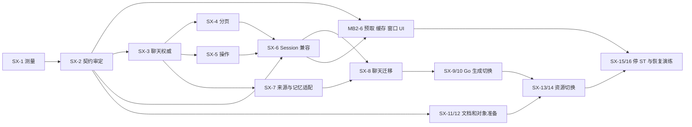

# 2026-11-06 ST 服务端退出计划与阶段 0 测量

状态：Draft，配套 [ADR-0013（Proposed）](../decisions/0013-leave-sillytavern-server.md)。Owner 已决定退出 ST 服务端；本文供总调度审阅接口与拆分。本轮只新增本文和 ADR，不改产品、specs、TODO、Backlog，不 commit/push。

## 1. 审计范围、证据与结论

基线为 detached `ecac91ad1864c17de759484203327755ac41ee90`。已读根 `AGENTS.md`/`AGENTS.override.md`、ADR-0009/0011/0012、ST 集成、server-plugin、patches README；后续以代码消解 README 的历史阶段描述。没有读 `config.txt`、私有环境或凭据，没有运行 Docker、受管场景、真实模型、开发库或生产库。

清单覆盖 `desktop-ui/src`、`extension/vc-model-settings`（含独立引擎及卡片端口）、`server-plugin/virtual-companion`，追踪 `request/post/raw/generate`、fetch、动态 URL、静态资源、原生调用及供应商间接调用。排除 harness/测试调用，另列仍在过渡期的原生路径及被拒绝的生成出口。这里的“调用”表示代码可达的请求入口，不表示本轮运行过该接口。

本工作树没有生成的 `desktop/locked-source/` 或上游检出。为避免把供应商依赖当作空白，按 `upstream.lock.json` 的**精确 commit**将公开源码只读下载到 `/tmp/next-st/st-exit-audit/upstream/`，按 `scripts/lib/desktop-source-modules.mjs` 的 74 个模块选择规则提取/转译到临时目录，并重放 EJS/MVU 补丁（输入/输出 SHA 校验通过）。临时审计跳过 ESM import 路径改写和库打包；两者不改变被查 HTTP 调用或行数，不构成生产构建验证。TypeScript 审计解析器为仓库锁定 5.9.3，下载完整性按 lock 校验。

| 审计引用缩写 | 完整位置 / 版本 |
|---|---|
| `D/` | `integrations/sillytavern/desktop-ui/src/` |
| `E/` | `integrations/sillytavern/extension/vc-model-settings/` |
| `S/` | `E/desktop/standalone/` |
| `P/` | `integrations/sillytavern/server-plugin/virtual-companion/` |
| `L/` | 由上述规则生成的 `E/desktop/locked-source/`；行号为临时同规则提取结果 |
| `U/` | [ST 7e8663cd9c184a550b37238218bdd32c6efc68e9](https://github.com/SillyTavern/SillyTavern/tree/7e8663cd9c184a550b37238218bdd32c6efc68e9/) 原始源码，相对根目录 |
| Helper | [JS-Slash-Runner 0af421068e7c03b6b0a71b68feb79d201164edeb](https://github.com/N0VI028/JS-Slash-Runner/tree/0af421068e7c03b6b0a71b68feb79d201164edeb/) |
| EJS | [ST-Prompt-Template d6f520d149aba146305b0b781ddd691d449c28d2](https://github.com/zonde306/ST-Prompt-Template/tree/d6f520d149aba146305b0b781ddd691d449c28d2/) |
| MVU | [MagVarUpdate d03b7dc8a6ebf9bd611c7e2dc91f3b35462deebc](https://github.com/MagicalAstrogy/MagVarUpdate/tree/d03b7dc8a6ebf9bd611c7e2dc91f3b35462deebc/)；`artifact/bundle.js:2` 为压缩长行，用函数/路径锚点定位 |

三个先行结论：

1. `st_message_source` 是已选候选的记忆来源镜像，不能拿它直接替代全量 JSONL；它缺少其他 swipe、任意 extra、变量与原始头部。
2. 分页必须进入共享 Session 数据边界。只对 React 消息列表虚拟化，仍会在打开、保存和卡片初始化时读取/处理整份历史。
3. 本基线只有 **24 个 `CORE_PATCH_SPECS`、28 个顶层 JSON 规格**。用户所述“30”与代码不符；§3 列尽实际 28 个，不补造两项。退出全部 ST 核心补丁的方向不变，4 个浏览器资产规格另行保留/调整。`patches/memorycore/` 是另外的独立集合。

## 2. 完整依赖清单

### 2.1 调用边界和请求格式约定

`D/data/client.ts:150` 创建带身份守卫的 fetch，接 `S/client.js:10` 的 POST JSON 端口；`D/runtime/session-bridge.ts` 接 `S/session.js`。下表 **P = POST**，除写明者外请求/响应均为 JSON，所有 ST 请求同源、Cookie、ST CSRF；受管写请求还带捕获的 Go account/session 双身份头。空参数为 `{}`。上传端口用 multipart 字段 `avatar`，不是 Go ASR 的 `file`。`vc_changes` 是 `[{path:string[], before:{exists,value?}, after:{exists,value?}}]`，数组整体提交、字面键保留，冲突整批 409。

这些格式是**当前接口**，不是 §4 的新接口。路径去向用 1/2/3/4 表示迁移阶段。复用的 endpoint 合并为一行，但调用文件/行号分别列出。

### 2.2 共享 UI、引擎、卡片实际 ST 数据/生成 HTTP 面

| 方法与路径 | 调用方文件:行（含间接消费者） | 语义与数据格式 | 去向 |
|---|---|---|---|
| GET `/csrf-token` | `S/client.js:31` | `{token}`；初始化 ST CSRF | 3：Go 会话/CSRF 适配，旧页身份不自动刷新 |
| GET `/version` | `S/cards/index.js:44`；MVU `artifact/bundle.js:2` `_wait_init` | `{pkgVersion,...}`；供应商能力/版本判定 | 3：兼容能力清单；不可伪报最新 ST 版本 |
| P `/api/settings/get` | `S/client.js:27`；`E/desktop/tavern-controller.js:415`；`D/data/queries/tavern.ts:242` | 设置包：`settings` JSON 字符串、各预设名称/内容数组及宿主配置 | 3：版本化文档读取 |
| P `/api/settings/save` | `E/settings-documents.js:87`；`E/desktop/tavern-controller.js:1252,1326`；`D/features/settings/CompanionStyle.tsx:70`；Helper 变量/脚本/正则保存间接调用 | 全设置或 `{vc_changes}`；200/409；全局变量、人设、主题、脚本开关也在此 | 3：局部文档提交 |
| P `/api/characters/all` | `S/client.js:36`；`E/desktop/tavern-controller.js:419`；`D/data/queries/tavern.ts:249` | 角色数组，含 avatar、卡片元数据/`json_data` 等 | 3 |
| P `/api/characters/get` | `S/session.js:167`；`E/desktop/tavern-controller.js:423`；`D/data/queries/tavern.ts:257` | `{avatar_url}` → 单角色文档 | 3 |
| P `/api/characters/chats` | `S/session.js:571`；`S/cards/helper-character.js:40`；`S/cards/ejs-host.js:472`；`D/runtime/session-bridge.ts:1562` | `{avatar_url,simple?}` → 聊天文件摘要数组（file_name/file_id/metadata 等）；不存在可 `{error:true}` | 1：会话列表；保留文件别名 |
| P `/api/characters/merge-attributes` | `E/persona.js:122`；`S/business.js:7`；`S/session.js:185`；`S/cards/index.js:356`；`S/cards/helper-host.js:214,251`；`S/cards/helper-worldbook.js:288`；`E/desktop/tavern-controller.js:1273,1322`；`D/data/queries/characters.ts:500` | `{avatar,data:{...}}`（也允许原生平铺字段）；合并卡属性/世界书绑定/脚本数据/稳定 characterRef；通常空 200，批量有统计对象 | 3：字段条件提交，不能把当前无条件 merge 扩散到新 API |
| P `/api/characters/import` | `S/business.js:17`；`E/desktop/tavern-controller.js:1465`（上传器 :1446） | multipart `avatar,file_type`（json/png/charx 等当前转换器支持格式）；`{file_name}` 或 error | 3：卡片导入任务、原二进制与资源 |
| P `/api/characters/export` | `E/desktop/tavern-controller.js:2010`；原生 `U/public/script.js:12053` | `{avatar_url,format:'json'|'png'}` → 下载 JSON/PNG 字节；独立 UI 当前传 json，PNG 是必须保留的交换能力 | 3 |
| P `/api/characters/duplicate` | `E/desktop/tavern-controller.js:2053` | `{avatar_url}` → `{path}`；新卡副本 | 3：新身份 |
| P `/api/characters/delete` | `S/session.js:573`；`D/runtime/session-bridge.ts:1566` | `{avatar_url,delete_chats,vc_f2_chats:[{path,expected}]}`；先核验子聊天、墓碑再删卡，200 | 1 接管聊天部分，3 接管卡；跨域删除任务 |
| P `/api/chats/recent` | `S/client.js:37`；`E/conversations.js:107` | `{metadata:true,...}` → 最近聊天摘要数组，当前不是消息分页 API | 1：有界会话列表 |
| P `/api/chats/get` | `S/client.js:38`（`S/session.js:155` 消费）；`E/f2-logic.js:273`；`S/cards/ejs-host.js:487` | `{avatar_url,file_name,ch_name?}` → `[header,...messages]`，整份 JSONL 解析后 JSON 数组；F2 头部基线 | 1：分页；完整读取兼容聚合器 |
| P `/api/chats/group/get` | `E/f2-logic.js:273`；`S/cards/ejs-host.js:486` → `L/helper/function/raw_character.js:56` | `{id}` → 群聊完整记录数组；不得擅自按单聊删除首消息 | 1：保留群聊格式归一化规则 |
| P `/api/chats/save` | `S/session.js:114,538` → `E/f2-logic.js:109`；Helper/MVU/EJS 编辑经 Session | `{avatar_url,file_name,chat:[header,...]}`；F2 在 `chat[0].chat_metadata.vc_f2`，分支另带 parent；`{vc_f2:{id,revision},...}` | 1：操作提交；旧全量写仅过渡适配 |
| P `/api/chats/export` | **MVU `artifact/bundle.js:2` 清理前导出函数**，经 `S/cards/index.js:598` 装入补丁版；原生 `U/public/script.js:11517` | `{is_group,avatar_url,file,exportfilename,format:'jsonl'}` → **`{message,result:JSONL字符串}`**；不是直接流下载 | 1：旧信封适配 + 新流式 JSONL 导出 |
| P `/api/worldinfo/list` | `E/desktop/tavern-controller.js:427`；`D/data/queries/tavern.ts:264` | 世界书摘要数组（名称及额外文档字段） | 3 |
| P `/api/worldinfo/get` | `S/engine/runtime.js:252,262`；`S/cards/ejs-host.js:434`；`E/desktop/tavern-controller.js:431`；`D/data/queries/tavern.ts:271` | `{name}` → `{entries:{uid:entry},...}`；提示词扫描、EJS include、Helper/MVU 世界书读取 | 3 |
| P `/api/worldinfo/edit` | `E/settings-documents.js:87`；`S/cards/helper-worldbook.js:214`；`E/desktop/tavern-controller.js:1329` | `{name,data}` 或 `{name,vc_changes}`；创建/编辑条目与未知字段，200/409 | 3 |
| P `/api/worldinfo/delete` | `S/cards/helper-worldbook.js:326`；`E/desktop/tavern-controller.js:1875` | `{name}` → 状态响应；解除引用由调用者处理 | 3：文档删除及引用核对 |
| P `/api/presets/save` | `E/settings-documents.js:87`；`S/cards/helper-host.js:220,258,284`；`E/desktop/tavern-controller.js:1328` | `{apiId,name,preset}` 或 `{apiId,name,vc_changes}` → `{name}`；Helper 预设脚本持久化走此路 | 3 |
| P `/api/avatars/get` | `S/personas.js:35`；`E/desktop/tavern-controller.js:435`；`D/data/queries/tavern.ts:278` | `{}` → 头像文件名数组 | 3 |
| P `/api/avatars/upload` | `E/desktop/tavern-controller.js:1922` → :1446 | multipart `avatar`（可含 overwrite_name/crop）→ `{path}` | 3：对象上传+文档关联 |
| P `/api/avatars/delete` | `E/desktop/tavern-controller.js:1942` | `{avatar}` → `{result:'ok'}` | 3 |
| P `/api/backgrounds/all` | `E/desktop/tavern-controller.js:439`；`D/data/queries/tavern.ts:285` | `{}` → `{images:[{filename,isAnimated}],config}` | 3 |
| P `/api/backgrounds/upload` | `E/desktop/tavern-controller.js:1969` → :1446 | multipart `avatar` → 文件名文本 | 3 |
| P `/api/backgrounds/rename` | `E/desktop/tavern-controller.js:1982` | `{old_bg,new_bg}` → 状态响应 | 3：别名更新，不复制对象 |
| P `/api/backgrounds/delete` | `E/desktop/tavern-controller.js:1998` | `{bg}` → 状态响应 | 3 |
| P `/api/images/upload` | `D/features/settings/StickerSettings.tsx:218,220`；`E/stickers.js:192` | `{image:base64,format,ch_name,filename}` → `{path}`；表情图片 | 3：同源有鉴权对象 API |
| P `/api/images/delete` | `D/features/settings/StickerSettings.tsx:259,261`；`E/stickers.js:223` | `{path}` → JSON/状态响应 | 3 |
| P `/api/tokenizers/openai/count?model={model}` | `S/engine/tokenizers.js:229`（实际 request :252）；EJS `S/cards/ejs-host.js:431` | `[{content,...}]` → `{token_count}`；缓存未命中按消息串行调用 | 2：等价 tokenizer/缓存；不能随意换估算 |
| P `/api/backends/chat-completions/bias?model={model}` | `S/engine/st/scripts/openai.js:599` | logit bias 条目数组 → tokenId 到 bias 的映射 JSON | 2 |
| P `/api/backends/chat-completions/generate` | `S/engine/computation.js:681`；`S/engine/runtime.js:242,336`；`S/cards/helper-generate.js:3,4`；EJS scoped generate `S/cards/ejs-host.js:319` | ST `generate_data`（messages、source、vc-go 标记、参数、工具、记忆/剧情上下文）；SSE chat chunks 或 JSON completion；AbortSignal 停止 | 2：共享引擎 → Go 三协议代理 |
| P `/api/backends/chat-completions/status` | **MVU `artifact/bundle.js:2` 的模型列表适配**；原生连接页；`P/lib/status-bridge.js` 接管受管标记 | `{chat_completion_source:'custom',custom_url,custom_include_headers?,...}` → `{data:[model...]}`；可能是插件接管或原生路径，非默认生成请求 | 2：显式受控连接检查；保留报错语义，不恢复浏览器 Key 权威 |

### 2.3 卡片脚本间接面：不能只搜索 UI 的 fetch

| 脚本能力 / 供应商 | 实际链路与 HTTP 汇合点 | 兼容要求 |
|---|---|---|
| Helper `getChatMessages`、`SillyTavern.chat`、变量、MVU 重演 | `S/cards/helper-message.js:97` 同步读取完整内存；数据由 `S/session.js:155`、`/api/chats/get` 提供 | 已存在 API 不返回页片段冒充整段；见 §4.5 装载屏障 |
| Helper `set/create/delete/rotateChatMessages` | `S/cards/helper-message.js:176,398,466,503` → Session 保存 → `/api/chats/save`；MVU 候选变量同路 | 追加、删除、重排、swipe 及变量同事务，迟到脚本不得写新会话 |
| Helper `getChatHistoryBrief/Detail` | `S/cards/helper-character.js:29,46` → `L/helper/function/raw_character.js:56` → `S/cards/ejs-host.js:470` | `/api/characters/chats` + **逐会话** `/api/chats/get` / `/api/chats/group/get`；不只当前会话，不可删掉批量全史 API |
| EJS 的 `RawCharacter`、历史和世界书函数 | `S/cards/ejs-host.js:434,470`；`L/ejs/desktop.js:2` 绑定该 host | 与上一行及 `/api/worldinfo/get` 相同；提取版 EJS 无额外固定 ST HTTP 路径，模板生成仍走唯一 Session |
| Helper/MVU 的世界书创建、替换、增删、重绑定 | `S/cards/helper-worldbook.js:180,201,214,233,274,281,302,323` | `/api/worldinfo/get/edit/delete`、`/api/characters/merge-attributes`、`/api/settings/save`、聊天 metadata 保存都必须迁移 |
| Helper 脚本设置/全局变量/角色变量/预设变量/正则 | `S/cards/helper-host.js:214,220,251,258,281`；`helper-variables.js:97,113,118,136,152`；`helper-regex.js` | 卡范围 → merge-attributes；预设 → presets/save；全局/扩展 → settings/save；消息/chat 变量 → chats/save |
| Helper `generate/generateRaw`，EJS 嵌套生成，MVU 额外处理 | `S/cards/helper-generate.js:3`、`S/cards/ejs-host.js:319`、`S/engine/runtime.js:336` | generate + tokenizer + bias + 世界书 + 媒体读取；保留受控用途/工具/取消/预算，不能另开不计费出口 |
| **MVU 内嵌直连** | 压缩 `artifact/bundle.js:2` 及按两份补丁得到的 `mvu-desktop.js` | `/version`、`/api/chats/export`、`/api/backends/chat-completions/status` 三个固定路径均保留；状态分支是可选模型列表，未实测其联网可用性 |
| locked-source Helper/ST | 74 模块选择闭包；例如 `desktop-source-modules.mjs:599` 附近 raw_character、character/persona 的 selected declarations | 原始 Helper 文件还含 characters/create/edit、avatars/upload/delete；**未被选入独立版**的函数不误报为独立版调用，过渡原生版见下一节 |
| Slash、宏、显示正则、格式化 | `S/engine/slash-ports.js`、`S/cards/helper-slash.js` 与 `L/st/scripts/*` | 选择闭包无额外固定 HTTP 路径；通过 Session/设置/生成端口落地，保留命令错误及状态语义 |

卡片是可执行代码，任意自行编写的 `fetch(url)` / 动态 import 不能从仓库穷举目标。这里列尽**锁定供应商与自有引擎的固定/构造路由**，并追踪其公开 API；不能据此声称支持全体第三方插件。迁移验收用已支持复杂卡脚本的请求捕获与阻断未知 ST 路由来查漏；不把任意旧 URL 透传为不受控 Go 代理。

### 2.4 静态资源也是服务端依赖

| GET/HEAD 路径 | 调用方文件:行 / 来源 | 数据与阶段 3 去向 |
|---|---|---|
| `/`、`/desktop/`、`/desktop/assets/*`、`/m/*` | `P/lib/host-auth.js:222` 起；React 两入口 | HTML 身份 meta、JS/CSS/font/image；Go 鉴权入口 + 同源静态发布；缓存按账号/会话隔离 |
| `/native/` | `P/lib/host-auth.js:233`；ADR-0012 过渡消费者 | 完整 ST HTML；阶段 4 在手机退出条件满足后删除 |
| `/thumbnail?type=avatar&file=...`（也有 bg）、`/characters/*` | `E/conversations.js:27`、`E/chat-logic.js:16,500`、`E/instance-logic.js:582`；`S/cards/ejs-host.js` 的 getThumbnailUrl | 头像/缩略图二进制；Go 鉴权图片变换或预生成派生对象，原图留存 |
| `/User Avatars/*`、`/backgrounds/*`、`/user/images/*` | `S/personas.js`、`D/shell/DesktopPreferences.tsx:22`、图片上传返回路径；卡片图片 | 受归属校验的 blob 别名；保留 URL 编码、MIME、缓存失效 |
| `/user/files/*` | `S/engine/resources.js:151,171` | 仅允许同源 user/files 附件文本读取；禁止路径穿越/跨域重定向的边界继续存在 |
| `/scripts/extensions/third-party/JS-Slash-Runner/src/iframe/*`、`.../lib/vendor/*`、`.../lib/tailwindcss.min.js` | `S/cards/index.js:32,368` | iframe API、parent_jquery、jQuery/UI/Vue/字体等锁定资源，同源自托管 |
| `/scripts/extensions/third-party/JS-Slash-Runner/lib/mvu-desktop.js`；原 `/user/files/mvu-bundle-d03b7dc8.js` | `S/cards/index.js:598,602` | MVU 原引用转独立派生物；兼容原引用并保留锁/SHA |
| `/scripts/extensions/third-party/vc-model-settings/desktop/standalone/cards/*`、`.../desktop/locked-source/*` | `S/cards/index.js:32`、`S/runtime.js` 及 ESM import 图 | 卡片 host、predefine、供应商 ESM；同源部署、相对 import 可用 |
| `/scripts/extensions/third-party/ST-Prompt-Template/dist/desktop-editor.js`、同目录 chunks/workers | `D/features/tavern/CodeField.tsx:45,48` | Monaco/EJS 编辑器资源，由 `scripts/lib/ejs-editor.mjs` 提取；不依赖 ST Node |
| `/scripts/vc-runtime/*` | 原生 F2/instance-binding，`E/instance-binding.js:90` | 全 profile 共用原生运行模块；阶段 4 随 `/native/` 退出 |
| `E/stickers-logic.js:356` 构造的扩展相对资源；消息 image/video/audio URL | `S/engine/st/scripts/openai.js:2009,2043,2078`；`S/engine/helper-computation.js:39` | 前者同源表情资源；后者 GET 转 Blob/data URL 的动态媒体。内置路径走对象别名，外部媒体仍按现有允许策略，不新增全网代理 |

### 2.5 原生过渡、F2 钩子与被拒绝路径

以下不是独立 React 新增依赖，但停止 ST 前不能留下原生写入绕过 Go。`U/` 行号为锁定**补丁前**源码，补丁锚点在 §3；最终删除前须复核 `/native/` 消费者已退役。

| 方法/路径 | 调用方文件:行 | 语义/数据格式与处理 |
|---|---|---|
| P `/api/chats/rename` | `U/public/script.js:10684` | `{is_group,avatar_url,original_file,renamed_file,vc_f2}` → `{ok,sanitizedFileName,vc_f2}`；阶段 1 别名更新 |
| P `/api/chats/delete` | `U/public/script.js:1339,1375` | `{avatar_url,chatfile,vc_f2}` → ok/token；阶段 1 墓碑 |
| P `/api/chats/import` | `U/public/script.js:9449` | multipart JSONL/既有转换格式、avatar_url/file_type、可选覆盖 F2；`{res,fileNames}`；阶段 1 |
| P `/api/chats/search` | `U/public/script.js:8583` | `{avatar_url,group_id?,query}` → 命中文件摘要；新 UI 当前也有内存查找，分页后不可只搜索已加载页 |
| P `/api/chats/group/save` | `U/public/scripts/group-chats.js:642,738,2389`；`bookmarks.js:431` | `{id,chat:[...]}` + 头部 F2 → ok/token；阶段 1 |
| P `/api/chats/group/delete` | `U/public/scripts/group-chats.js:2250,2293` | `{id,vc_f2}` → ok/token；阶段 1 |
| P `/api/chats/group/import` | `U/public/scripts/group-chats.js:2320` | multipart 文件 → `{res:chatname}`；阶段 1 |
| P `/api/chats/group/info` | `U/public/scripts/group-chats.js:2173` | `{id}` → 群聊摘要；阶段 1 |
| P `/api/groups/all`、`/api/groups/edit`、`/api/groups/create`、`/api/groups/delete` | `U/public/scripts/group-chats.js:759,156,2120,1326`；`bookmarks.js:381` | 群组 JSON、成员/元数据、删除时 `vc_f2_chats`；阶段 1 聊天关联 + 阶段 3 文档；完整保存/批量删除都纳入门禁 |
| P `/api/characters/rename` | `U/public/script.js:7208` | `{avatar_url,new_name,vc_f2_chats}` → 新 avatar/token 清单；阶段 1 子聊天别名，阶段 3 卡文档 |
| P `/api/characters/create`、`/api/characters/edit` | Helper 原 `src/function/character.ts:195,320`；`src/function/lorebook.ts:68` | multipart 卡字段/头像 → 文本文件名或状态；未选入独立版；原生退出后不必保持原生表单实现，但卡能力须在新文档 API 覆盖 |
| P `/api/data-maid/report`、`/finalize`、`/delete`（同前缀）；GET `/api/data-maid/view?hash&token` | `U/public/scripts/data-maid.js:69,87,332,285` | 清理报告/令牌、文件哈希清单 + 聊天 F2 基线、文件预览；清理职责迁 Go 归属/引用清理，不保留 ST 管理页 |
| GET `/api/users/me` | `U/public/scripts/user.js:64`；`P/lib/host-auth.js:178` 唯一例外 | 当前 profile JSON；迁应用 profile/能力适配，其余 ST 用户管理拒绝 |
| P `/api/backends/text-completions/generate`、`/api/backends/kobold/generate`、`/api/horde/generate-text`、`/api/novelai/generate` | §3 四份 guard；`P/lib/unmanaged-generation-guard.js` | 原生文本生成旁路，受管下 `VC_UNVALIDATED_GENERATION`；阶段 2/4 保持拒绝/移除，不迁为新能力。`/api/backends/koboldhorde/generate` 只是上游死映射，不是有效路由 |

上表的原生钩子由 `P/lib/f2-routes.js:32` 暴露，直接调用 `getF2Store`，不是插件再向 ST 发一次 HTTP。plugin 自己也直接 import `src/users.js`、`node-persist`、`src/endpoints/tokenizers.js`（`P/index.js:37,38,59`）；这些**非 HTTP 依赖**分别迁 Go 身份/迁移映射及 tokenizer，阶段 4 必须无残留。

### 2.6 ST 上的 Go 管理桥（全路径族）

公开前缀 **`/api/plugins/virtual-companion/go` + 下表路径**。`E/api.js:138` 为统一实际 fetch，`P/index.js:54` 挂载，`P/lib/admin-bridge.js:26` 起为白名单；响应原样透传 Go JSON/ErrorEnvelope，分页保留 `X-Next-Cursor`，特殊二进制见表。它们不是 ST 数据模型，但 ST 停机前要将调用方切到应用同源 `/api/v1/...`，过渡别名仍做相同认证。不得把浏览器请求升级为服务令牌请求。

| 方法及 Go 后缀路径（逐路径列出） | 调用方文件:行 | 语义/请求格式 |
|---|---|---|
| GET `/api/v1/auth/session` | `E/api.js:179,272` | 当前身份/会话状态 JSON |
| POST `/api/v1/auth/reauth` | `E/api.js:269` | `{password}` → ok，再认证 |
| POST `/api/v1/auth/password`；POST `/api/v1/auth/logout` | `E/api.js:273,283` | 改密 `{currentPassword,newPassword}`；注销 `{}` |
| GET `/api/v1/auth/sessions`；DELETE `/api/v1/auth/sessions/{id}` | `E/api.js:274,275` | 会话列表/撤销 |
| GET `/api/v1/auth/trusted-devices`；DELETE `/api/v1/auth/trusted-devices/{id}` | `E/api.js:276,281` | 信任设备列表/撤销 |
| POST `/api/v1/admin/accounts/{id}/authenticator-reset` | `E/api.js:286` | 重置验证器，不回密钥 |
| GET、PUT `/api/v1/consents` | `E/api.js:284,285` | 同意状态与记录 JSON |
| GET `/api/v1/admin/providers`；PUT `/api/v1/admin/providers/{id}` | `E/api.js:199,218` | 模型配置、凭据状态/清除及 expectedRevision；写凭据不回显 |
| POST `/api/v1/admin/providers/{id}/models/discover`；POST `/api/v1/admin/providers/{id}/models/{profile}/verify-tool-calls` | `E/api.js:251,260` | 显式探测/工具验证 JSON，未来验收不得默认为离线 |
| GET `/api/v1/admin/model-purposes`；PUT `/api/v1/admin/model-purposes/{purpose}` | `E/api.js:233,238` | 用途列表、revision 条件绑定 |
| GET `/api/v1/admin/local-models`；PUT `/api/v1/admin/local-models/rerank` | `E/api.js:223,228` | 本机能力；`{enabled,expectedRevision}` |
| GET `/api/v1/auth/admin/usage?month=...` | `E/api.js:175` | 用量账本汇总 |
| POST `/api/v1/st/bindings`；POST `/api/v1/st/sources/reconcile`；POST `/api/v1/st/memory/recall` | `E/api.js:205,213,209` | 稳定实例/会话绑定；`{chatIdentities}`；已绑定会话的召回请求 JSON；阶段 1 改内部权威实现，外部身份不变 |
| GET、PATCH `/api/v1/relationships[/{id}]` | GET `E/api.js:300`；PATCH `E/instance-logic.js:306`、`E/voice-settings.js:106` | GET 只用集合；PATCH 只用单项，名称/声音等字段 |
| GET `/api/v1/relationships/{id}/companion-state` | `E/desktop/status-card.js:46` | 陪伴状态 JSON |
| GET `/api/v1/relationships/{id}/memories`；GET `/api/v1/memories/{id}`；GET `/api/v1/memories/{id}/evidence` | `E/api.js:320,322,323` | 过滤/游标列表；详情/证据 |
| PATCH、DELETE `/api/v1/memories/{id}`；PUT、DELETE `/api/v1/memories/{id}/pin` | `E/api.js:324,325,329,330` | `{summary,expectedVersion}`、遗忘、钉住；删除/失效屏障保留 |
| POST `/api/v1/relationships/{id}/reply-suggestions` | `E/api.js:332` | 最近 ≤8 条 `{role,text}` → suggestions |
| GET、POST `/api/v1/relationships/{id}/favorites`；DELETE `/api/v1/favorites/{id}` | `E/api.js:334,339,341` | 游标列表；`{chatFile,mesId,role,body,messageAt?}`；阶段 1 稳定 messageId 别名适配 |
| GET、POST `/api/v1/relationships/{id}/reminders`；DELETE `/api/v1/reminders/{id}` | `E/api.js:343,344,345` | `{text,remindAt,recurrence?}`；列表/取消 |
| GET `/api/v1/relationships/{id}/diary?month=...`；GET `/api/v1/diary/{id}` | `E/api.js:347,348` | 日记月列表/详情 |
| GET、PUT `/api/v1/incognito-pref` | `E/api.js:350,351` | `{defaultIncognito}`，不改变历史来源权利 |
| GET `/api/v1/voice/engines`；GET `/api/v1/voice/usage`；GET、PUT `/api/v1/voice/settings` | `E/api.js:301,303,302,304` | 引擎/用量/有 revision 的设置 JSON |
| POST `/api/v1/voice/preview`；POST `/api/v1/relationships/{id}/voice-clips`；GET `/api/v1/voice-clips/{id}` | `E/api.js:307,305,306` | 试听配置、已保存消息来源生成、片段状态 |
| GET `/api/v1/voice-clips/{id}/audio` | `E/voice-logic.js:84` | 有鉴权 WAV，Range/206/416；原对象路径不暴露 |
| POST `/api/v1/voice/asr` | `E/api.js:312` | multipart `file` WAV → 转写 JSON；ST multer 精确例外，Go 有界内存处理 |
| GET `/api/v1/inbox`；POST `/api/v1/inbox/{event}/read` | `E/inbox-logic.js:37,201`；`E/inbox-client.js:18` | 收件箱列表/已读 |
| GET、PUT `/api/v1/relationships/{id}/proactive-policy`；GET `/api/v1/relationships/{id}/follow-ups`；POST `/api/v1/follow-ups/{id}/cancel` | `E/inbox-logic.js:187,192,197`；`E/inbox-client.js:12` | 主动策略 JSON、跟进列表/取消 |
| GET、PUT `/api/v1/notification-channels`；GET `/api/v1/notification-deliveries` | `E/inbox-logic.js:206,211,215`；`D/data/queries/inbox.ts:242,268,282` | 渠道配置与投递记录 JSON |
| POST `/api/v1/story/runs`；GET `/api/v1/story/runs/{run}/actors/player/view` | `E/api.js:365,375` | `{conversationId,caseId}`；branchId/worldVersion 查询，玩家视图 |
| POST `/api/v1/story/runs/{run}/actions`；POST `/api/v1/story/runs/{run}/rewind` | `E/story-action.js:49,54` | 行动/回档、世界版本 JSON |
| GET `/api/v1/story/runs/{run}/projections`；POST `/api/v1/story/runs/{run}/projections/{event}/confirm` | `E/story-logic.js:529`、`D/features/story/useStory.ts:694`；`E/story-action.js:61` | 未确认投影列表/确认 |
| POST `/api/v1/story/runs/{run}/participants/{actor}`；POST `/api/v1/story/runs/{run}/epilogue` | `E/story-action.js:66,72,75,79` | 陪伴入局/结局采纳或丢弃 JSON |
| POST `/api/v1/exports`；POST `/api/v1/exports/recover`；GET `/api/v1/exports/{id}`；GET `/api/v1/exports/{id}/download?token=...` | `E/api.js:288,289,290,294` | `{currentPassword}`、状态 JSON、一次性 Blob 下载 |

白名单还含 POST `/api/v1/auth/login`、POST `/api/v1/auth/sessions/revoke-all`（`P/lib/admin-bridge.js:56,85`）以及 POST `/api/v1/inbox/{event}/call`（`P/lib/inbox-ui-routes.js:14`）。本基线指定前端范围未找到它们经管理桥的实际生产调用；不能把“允许路由”误算成已使用或可删的能力。手机来电迁移时复核 call 消费者。登录实际走下面的 auth 门面。

### 2.7 auth 门面、Go → ST 私有调用与生成期间反向依赖

| 方法/路径 | 调用方文件:行 | 语义/数据格式及去向 |
|---|---|---|
| GET `/auth/`、`/auth/index.js`、`/auth/style.css` | `P/lib/host-auth.js:8,168`；未登录页面跳转 | 登录资源；3 迁同源 Go 静态入口 |
| GET `/auth/access` | `P/auth/index.js:228` | `{allowed:true}`；ST/Go 会话绑定后进入应用 |
| GET `/auth/api/session` | `P/auth/index.js:451` | 代理 Go session JSON |
| POST `/auth/api/login`、`/auth/api/password` | `P/auth/index.js:361,443` | 登录 `{account,password}`；改密 JSON |
| POST `/auth/api/challenges/{id}/authenticator-setup`、`authenticator-confirm`、`totp`、`recovery-code`（同 challenge 前缀） | `P/auth/index.js:262,371` | 设置/确认 TOTP、验证码/恢复码及信任设备参数 → Go challenge JSON |
| DELETE `/auth/api/account` | `E/api.js:138,291` | `{currentPassword}` → 跨域删除状态；不是管理桥放行路径 |
| POST `/auth/api/logout`、`/auth/api/reauth` | `P/lib/host-auth.js:13` 白名单；原生注销补丁接 Go | JSON；复用 Go auth 语义；不复活 `/api/users/logout` |
| POST `/internal/v1/st/sources` | `backend/internal/stsource/client.go:122`；`P/lib/source-bridge.js:6,50` | `{ownerAccountId,chats:[{chatIdentity,revision?}]}`（1–64）→ `{snapshots}`，PRESENT/UNKNOWN/DELETED/UNAVAILABLE、notModified 或选中来源数组；1 改 Go 本地 reader |
| POST `/internal/v1/st/inbox` | `backend/internal/stsource/client.go:227`；`P/lib/inbox-bridge.js:91` 起 | `{ownerAccountId,file,event,lease}` → saved/stopped/waitingHost/associated/acked/readback；1 改同一聊天事务，eventId 去重 |
| POST `/internal/v1/st/data/export` | `backend/internal/stsource/data.go:50`；`P/lib/source-bridge.js:7,35` | `{ownerAccountId}` → 文件内容副本 JSON，当前 ST 域 64 MiB/10,000 文件上限；1/3 迁各权威域导出 |
| POST `/internal/v1/st/data/delete` | `backend/internal/stsource/data.go:64`；`P/lib/source-bridge.js:8,29` | `{ownerAccountId,expectedHandle}` → 清理确认；冻结/墓碑/幂等不变 |
| ST → Go GET `/api/v1/auth/session`，POST `/api/v1/service/st/profile` | `P/lib/host-auth.js:179,202`；`P/lib/go-client.js:158` | Cookie 核验；可信服务通道 `{ownerAccountId,handle}` 注册。身份检查保留，HTTP/handle 适配阶段 3/4 消失 |
| ST → Go POST `/api/v1/service/model-purposes/{purpose}/resolve` | `P/lib/go-client.js:185`；`generate-bridge.js:155` | 服务 token + 可信 Owner、配置 revision → provider/model/凭据，2 改 Go 内部取用，凭据永不回浏览器 |
| ST → Go POST `/api/v1/service/model-usage/reservations`、`/{id}/settle`、`/{id}/cancel` | `P/lib/go-client.js:41,51,65` | 预留/usage/取消 disposition；2 保留同一账本、改进程内调用 |
| ST → Go POST `/api/v1/st/tools/execute` | `P/lib/go-client.js:88` | 工具调用 JSON；2 保留可信工具策略和证据 |
| ST → Go GET `/api/v1/story/runs/{run}/actors/{actor}/view`、POST 同前缀 `/outbound-check` | `P/lib/go-client.js:110,130` | branchId/worldVersion 与最终 payload 核验；不同于浏览器仅 player 视图 |
| ST → Go POST `/api/v1/st/memory/recall` | `P/lib/memory-guard.js:159` | 最终发出前重核、替换/清除过期资料槽；2 内部调用但不能省略 |

四条 `/internal/v1/st/*` 拒绝浏览器 Origin、仅可信服务令牌 + Owner 映射。插件没有“向 ST 自己发 HTTP”的后台循环；其出站网络是 Go 和 provider，ST 存储通过本地函数。provider 目标来自 Go resolve，不能当作 ST 固定端点纳入路径兼容；三协议及流转换由阶段 2 等价迁移。

## 3. 补丁职责与迁移后去向

来源：`integrations/sillytavern/scripts/lib/paths.mjs:53` 与 `integrations/sillytavern/patches/*.json`。每行一个实际规格；C 表示列入 CORE_PATCH_SPECS，A 表示浏览器资产。所有 C 在阶段 4 删除注册、运行装配及对应 ST 专属实现；功能验证迁至新实现，不能以删测试代替验证。

| # | 规格（`patches/` 下） | 当前职责 | 去向/删除条件 |
|---|---|---|---|
| 1 C | `st-host-auth.json` | 全资源/API 前 Go 身份/TOTP/handle 门禁、私有上传目录、ASR 绕过磁盘 multer | 3 迁 Go 同源入口/有界上传；4 无 ST 用户解析后删除 |
| 2 C | `st-go-login-client.json` | 原生禁第二套账号管理，注销 Go 会话 | 3 Go auth；4 `/native/` 退役删除 |
| 3 C | `st-client-f2.json` | 原生单聊快照 CAS、迟到来源/草稿保护，settings 条件保存，metadata 延迟保存去重 | 1 迁 Session 操作提交；3 配置；4 删除原生补丁 |
| 4 C | `st-settings-commit.json` | settings 的 `vc_changes` 旧值比较与原子写 | 3 Go 文档条件操作 |
| 5 C | `st-presets-commit.json` | presets 条件写 | 3 同上 |
| 6 C | `st-worldinfo-commit.json` | worldinfo 条件写 | 3 同上，保留 UID/未知键 |
| 7 C | `st-worldinfo-client-commit.json` | 原生世界书客户端维护原始/归一化基线 | 3 共享客户端文档适配；4 原生退出 |
| 8 C | `st-preset-client-commit.json` | 原生预设局部提交与草稿/队列基线 | 3 同上 |
| 9 C | `st-f2-chats.json` | 聊天读/写/删/改名/导入/群聊统一 F2；原生格式转换/备份仍保留 | 1 Go 操作/交换格式；4 删除原端点 |
| 10 C | `st-f2-characters.json` | 角色改名/删除前批量核对聊天；BYAF 导入副本新身份 | 1 子聊天原子迁移/墓碑，3 卡文档操作 |
| 11 C | `st-f2-groups.json` | 群组删除先核验所有聊天；启动旧群聊迁移复用 F2 | 1 群聊/迁移器，3 群组文档 |
| 12 C | `st-f2-data-maid.json` | DataMaid 清理聊天必须逐项基线+墓碑 | 1 删除服务，3 引用回收；不重建 ST 清理 UI |
| 13 C | `st-f2-group-client.json` | 原生群聊写入/删组/删聊天携带基线 | 1 兼容适配，4 退役 |
| 14 C | `st-f2-bookmarks-client.json` | 书签/分支捕获父基线，群聊 fork 不旁路保存 | 1 显式 fork/order 操作、稳定分支身份 |
| 15 C | `st-f2-data-maid-client.json` | 使用报告生成时基线，不临删除刷新基线强删 | 1 保留预览到执行的前置条件 |
| 16 C | `st-f2-extensions.json` | 卡字段写入失败传播；metadata 后台冲突进入同一留稿通道 | 1/3 错误传播与草稿；4 原生退出 |
| 17 C | `st-chat-completions-vc-bridge.json` | generate/status 钩子、取密、三协议分流、最终预算/记忆/剧情防线、用量预留结算/取消、reasoning/成功信封适配、日志收口 | 2 Go 生成代理等价实现；4 不再修改 ST 出站 |
| 18 C | `st-text-completions-vc-guard.json` | 拒绝未核验 text-completions 旁路 | 2 Go 仅允许受控协议；4 删除原路由 |
| 19 C | `st-kobold-vc-guard.json` | 拒绝 kobold 独立文本出口 | 同上 |
| 20 C | `st-koboldhorde-vc-guard.json` | 拒绝实际 `/api/horde/generate-text` 出口 | 同上，不迁死映射 |
| 21 C | `st-novel-vc-guard.json` | 拒绝 NovelAI 文本出口（非图片/语音） | 同上，不扩大协议范围 |
| 22 C | `st-memory-status-client.json` | 最终记忆状态响应头反馈；历史预算完成后的完整用户回合截断事件 | 2 Go 响应状态 + 共享引擎事件；记忆优化线保留顺序 |
| 23 C | `st-util-stream-error-log.json` | 流错误不记 provider 正文；AbortError 不致 ST 进程退出 | 2 Go SSE/取消/安全日志；4 ST util 不再部署 |
| 24 C | `st-fetch-wasm-realpath.json` | Jimp wasm 读取允许 node_modules 真实路径，仍拒绝数据目录 | 3 Go 图片管线或静态缩略图；4 不再需要 ST/Jimp 运行补丁 |
| 25 A | `helper-selfhost-runtime-assets.json` | Helper 默认 iframe 的 CDN 改锁定同源资源 | 保留同源资产目标；完整原生 Helper dist 停用时可删该 dist 补丁，但独立 iframe vendor 自托管/锁不能删 |
| 26 A | `mvu-current-message-lifecycle.json` | 移除丢弃快速 swipe 事件的全局 3 秒节流 | 保留，直到锁定上游等价修复且复杂卡事件回归通过 |
| 27 A | `ejs-desktop-runtime.json` | 抽离 EJS headless 入口；生成作用域和过期回调守卫 | 保留 browser 派生规则；只替换数据端口，无 ST Node 依赖 |
| 28 A | `mvu-desktop-runtime.json` | 独立脚本注册表、异步来源守卫、变量写回与重处理/重演保存生命周期 | 保留并适配新 Session 操作提交；不是 ST 核心服务器补丁 |

第 29/30 项在此基线不存在，须总调度确认是否来自其他分支/不同统计口径。MemoryCore 的 `index.json` 和其条目继续独立管理；把它们混入凑数会错误扩大退出范围。`desktop-source-modules.mjs` 的 AST 选择/替换、`ejs-editor.mjs` 的资源提取虽不是这 28 个 JSON，也属于需要保留锁、许可和回归的派生规则。

## 4. 聊天存储与分页历史契约（SX-2 冻结）

### 4.1 数据模型和统一边界

采用 PostgreSQL 为聊天在线权威：conversation 关联新的 chat/message/candidate/order/document/operation 数据结构，消息保留 ST 兼容 JSON（包含未知键）；blobstore 存 PNG/媒体/大型交换文件，不逐次保存一份整聊对象。具体表名与迁移版本在 SX-3 实施时决定。本节按总调度审定意见冻结进 [OpenAPI](../../specs/openapi/virtual-companion.yaml)，本轮只有契约，未实现接口、迁移或切换权威。

- `chatId` 是稳定 UUID，可信迁移等于旧 `vc_f2.id`；Go `conversationId/relationshipId` 保持已有十进制字符串，绝不把 JS Number 作为 bigint 载体。文件名、角色 avatar 是别名，改名不改 ID。
- `messageId` 保持 `vc_message_id`；`candidateId` 保持各 swipe 的 `extra.vc_source.id`。顺序由独立 `position` 与 `orderRevision` 描述，不能用数组 index 作为身份。追加的逻辑序号与展示排序分开；重排只修改受影响区间及 orderRevision。
- `chatRevision` 每次成功事务单调递增；`messageRevision`、`metadataRevision`、`orderRevision` 分域；`sourceRevision/sourceGeneration` 是记忆证据身份，不能用 chatRevision 替代。所有 revision 用十进制字符串传输。页/操作响应返回权威版本、canonical 数据和变更游标。
- 原始 `header`（包括未知字段）与 `metadata` 保留；保护字段 `vc_f2/vc_binding/vc_branch_root/vc_source/vc_message_id` 由服务端生成或可信迁移导入，普通上传/编辑不能授予自己权利。`mes/swipes/swipe_id/swipe_info/extra/variables` 的对应关系由服务端校验；选中候选的 text/extra 与 ST 展示字段同步。
- 默认只返回显示需要的数据 `view=display`：当前候选、消息身份/版本/顺序、显示 extra、候选摘要数量；`view=full` 才返回全部候选、变量与未知字段。display 结果显式标记 view，不允许拿它全量替换 full 数据。
- `authorityEpoch` 是服务端权威切换栅栏，所有写入携带读到的 epoch；旧 epoch 返回 409 `CHAT_AUTHORITY_CHANGED` 并保留草稿。它不等于单设备写租约。一次同会话生成仍有独立 run fencing，普通多设备编辑不被排他锁住。

单聊和群聊通过 `kind` 区分；群聊保持现有 F2 数据/说话者语义，不把 GROUP 塞进已有只允许 COMPANION/STORY 的 Go 绑定模式。尚无 Go conversation/relationship 绑定的旧群聊允许这些字段为 null；迁移不自动赋予它日常记忆共享权限。

### 4.2 机器真源与接口清单

机器真源为 `specs/openapi/virtual-companion.yaml`；本节不再保留第二份 YAML 草案。新增操作在
`specs/catalog/go-v1-api-scope.yaml` 登记为 **DEFER**（现有 catalog 无独立实现状态字段），逐项注明
“SX-2 已冻结、尚未实现，由 SX-3–SX-6 实现并验证后转 KEEP”。这不表示撤回 ADR-0013 的迁出决定，
也不宣称这些路由当前已存在。既有 `/conversations/...` 接口及 `listMessages` 保持不变。

实施回填（SX-4，2026-11-07）：五个聊天 GET（会话列表/详情、消息页/完整单条、changes）已实现并经合成隔离验证，
对应 catalog 转 KEEP。SX-5 实施回填：七个公开写接口及内部生成登记已实现，批次/回执/生成栅栏/inbox 去重同事务，转 KEEP；导入导出仍 DEFER。§4.4.1 修订契约 5f55e4c6 已经 Owner 复审通过。

下表路径均以 `/api/v1` 为前缀：

| 路径 | 方法 / operationId | 请求与响应 schema |
|---|---|---|
| `/chats` | GET `listStoredChats`；POST `createStoredChat` | `StoredChatPage`；`ChatCreateRequest` → `StoredChat` |
| `/chats/{chatId}` | GET `getStoredChat`；DELETE `deleteStoredChat` | `StoredChat`；`ChatDeleteRequest` → `ChatCommit` |
| `/chats/{chatId}/messages` | GET `listStoredMessages`；POST `appendStoredMessages` | `StoredMessagePage`；`ChatAppendRequest` → `ChatCommit` |
| `/chats/{chatId}/messages/{messageId}` | GET `getStoredMessage`；PATCH `editStoredMessage` | `StoredMessage`（full）；`ChatMessageEditRequest` → `ChatCommit` |
| `/chats/{chatId}/metadata` | PATCH `editStoredChatMetadata` | `ChatMetadataEditRequest` → `ChatCommit` |
| `/chats/{chatId}/operations` | POST `applyStoredChatOperations` | `ChatOperationsRequest` → `ChatCommit` |
| `/chats/{chatId}/changes` | GET `listStoredChatChanges` | `ChatChangesPage` |
| `/chats/{chatId}/forks` | POST `forkStoredChat` | `ChatForkRequest` → `ChatForkResult` |
| `/chats/imports` | POST `importStoredChat` | multipart `ChatImportRequest` → `ChatImportAccepted`（202） |
| `/chats/imports/{importId}` | GET `getStoredChatImport` | `ChatImportResult` |
| `/chats/{chatId}/export` | GET `exportStoredChat` | 完整 `application/x-ndjson`，响应头 `X-Chat-Revision` |

消息删除只有 `operations.kind=delete`，没有新 `/chats/.../messages/...` DELETE 路由。
所有写入只用 body `requestId`（UUID）去重，body `authorityEpoch` 校验权威；会话删除另外带 body
`chatRevision` 精确前置条件。导入的这两个字段也在 multipart body，不设置幂等请求头或双份键。
创建/导入前可从空会话列表响应读取账号级 `authorityEpoch`。

所有新接口显式复用现有 `cookieAuth`。写入复用 `StoryCSRF`、`StoryExpectedAccount`、
`StoryExpectedSession` 参数及既有 Origin 精确白名单规则；读取在身份头存在时比对。Cookie 身份始终是
唯一授权来源，身份头和 epoch 只是前置条件。认证失败不得自动切账号重放，资源不存在/非本人一律隐藏存在性。

`ChatOperation` 按 kind 使用 `oneOf` / discriminator，8 个分支的 envelope、target、preconditions、payload
均为关闭未知字段的类型化对象（无载荷的 delete/selectSwipe 为 null）。`data` 与字段值槽保留任意 JSON，
以兼容 ST 未知字段；这不允许扩展操作协议或修改受保护身份。

| kind / schema | target | preconditions | payload |
|---|---|---|---|
| edit / `ChatEditOperation` | messageId，可选 candidateId | baseRevision（messageRevision）；旧字段值在 changes.before | changes[{path,before,after}] |
| append / `ChatAppendOperation` | 会话根 `{}` | `{}`，不校验无关 chatRevision | messages[{clientMessageId,data}] |
| delete / `ChatDeleteOperation` | messageId | 精确 messageRevision | null |
| metadata / `ChatMetadataOperation` | 会话根 `{}` | baseRevision（metadataRevision）；旧字段值在 changes.before | changes，路径以 title/header/metadata 开头 |
| addSwipe / `ChatAddSwipeOperation` | messageId | 精确 messageRevision | candidate{candidateId,data}，默认保留旧选择 |
| selectSwipe / `ChatSelectSwipeOperation` | messageId + candidateId | 精确 messageRevision + observed selectedCandidateId | null |
| removeSwipe / `ChatRemoveSwipeOperation` | messageId + candidateId | 精确 messageRevision + observed selectedCandidateId | replacementCandidateId（移除当前选择必须给存活替代；否则为 null） |
| reorder / `ChatReorderOperation` | firstMessageId + lastMessageId 的连续区间 | 精确 orderRevision | messageIds，恰为该区间 ID 的排列 |

所有批次前置条件对事务开始状态校验，载荷依序应用，结束时检查候选/字段不变量；同一批 add+select 可共用
观测版本，不必猜中间 revision。新创建的 candidateId 可用于后续选择；edit/delete 目标及 reorder 区间须在
事务开始时存在。重叠字段、矛盾删除或指向已删除对象的操作拒绝；任一失败整批回滚。各变更域每事务只推进一次。

错误响应复用 `ErrorEnvelope`；409 的可选 details 按 `ChatConflictDetails` 给出目标/路径/版本，不回显正文。
新增 catalog 错误码：`CHAT_AUTHORITY_CHANGED`、`CHAT_CURSOR_EXPIRED`、`CHAT_CHANGES_EXPIRED`、
`IDEMPOTENCY_KEY_REUSED`、`OPERATION_RESULT_EXPIRED`、`CHAT_ID_REUSED`、`CHAT_GENERATION_FENCED`、
`CHAT_PAYLOAD_TOO_LARGE`、`CHAT_INVALID_OPERATION`、`CHAT_PRECONDITION_REQUIRED`、`CHAT_IMPORT_INVALID`、
`CHAT_IMPORT_EXPIRED`。其余复用 `INVALID_REQUEST`、`REVISION_CONFLICT`、身份/权利/限流/不可用错误码。
错误码 catalog 现有 entries 只有 code/order，无中文用户文案字段；本轮沿用该结构。

### 4.3 游标与可观测版本

- **方向**：消息页不传 before/after 时取末页；before 取严格早于边界的最近一页，after 取严格晚于边界的最近一页，与现有 `listMessages` 方向一致。两者互斥，同时传返回 400 `INVALID_REQUEST`；items 始终按展示顺序升序。非空页返回首/末消息的 beforeCursor/afterCursor，即使已到边界也可保留它们；空会话返回空数组、两 cursor=null、两 has*=false，不伪造 header 消息。
- **一致性**：使用当前状态 keyset，**不做版本化快照读取，不提供 snapshotRevision 或列表 snapshot**。opaque cursor 绑定 Owner、chatId、authorityEpoch、orderRevision、排序边界、view/过滤条件及到期时间。普通尾部追加、编辑、删除不推进 orderRevision；显式重排/插入推进它，使旧游标返回 410 `CHAT_CURSOR_EXPIRED`。每页 chatRevision 是 changes 追平起点，不是固定历史读取令牌；并发编辑/删除/追加通过 changes 对账。
- **一次打开**：`GET /chats/{chatId}/messages?include=chat` 从同一次读取返回显示页及完整 header、metadata、各域版本；省略 include 时不带 chat。默认 `view=display`，`view=full` 返回全部候选、变量及未知字段。单消息 GET 始终 full。
- **删除优先**：删除/权利撤销屏障高于任何游标；删除账号/会话后读取立即拒绝，已删除消息永不由旧游标返回正文。changes 返回删除 ID/整聊失效信息，客户端立即剔除缓存；404 不区分不存在或非本人。
- **过期与锚点**：游标有效 15 分钟。到期/重排后用 `anchorMessageId` 重新读取包含该锚点、以其结束的一页（最多 limit-1 条更早消息），不传 before/after；锚点也被删则收到 404，回到末页。changes 保留 7 天，过期返回 410 `CHAT_CHANGES_EXPIRED` 并重建当前页；不得跨 orderRevision 盲拼页面。changes 的 throughRevision 为最后完整事务，hasMore=true 时继续追平，不拆事务。
- **列表与搜索**：会话列表按 `(updatedAt DESC, chatId DESC)` 的排他 keyset 排序，cursor 绑定 Owner、过滤及到期时间，不维持列表快照。更新可能导致行移动，客户端按 chatId 去重并刷新首屏；不承诺并发更新期间无跳项。列表直接给摘要/条数及账号 authorityEpoch，不扫描正文；列表的 `q` 只搜标题/角色。Owner 2026-11-07 批准 SX-4 在消息分页增加 `q`：原值最多 200 个 Unicode 码点（超长 400 `INVALID_REQUEST`），trim 后对整聊当前选中候选的 `mes` 做 Unicode 大小写不敏感子串搜索，游标绑定查询，方向/锚点/has* 均按同一过滤集合；锚点不匹配返回 404。正文保持应用层加密，只能在 Go 有界解密扫描；不搜索未选候选，不把当前页查找冒充全聊搜索。SX-4 验收包含 20,000 条合成消息无命中全量扫描的单页 P95 和请求期间堆内存增量上限，测试口径、上限与实测值记入 NOTES。
- **容量**：页 default=50/max=200，响应软目标 ≤256 KiB；full 可按字节提早结束并给下一 cursor，至少返回一条符合条件的消息，**不能截断一条消息**。完整单消息（含候选）/操作上限建议 1 MiB/8 MiB；超限显式 413 `CHAT_PAYLOAD_TOO_LARGE`。导入预检报告旧数据超限，不丢字段；multipart 文件采用独立 256 MiB 上限。这是已冻结的实施参数，尚非当前服务已实施限制。

### 4.4 幂等、并发及生成提交

1. 写操作只有请求体 `requestId`（UUID）作为不可复用的幂等键；会话 DELETE 也有 body，导入为 multipart body。去重范围是 Owner + HTTP 方法/规范资源 + requestId。服务端保存 canonical 请求摘要及回执；同 ID 同 payload 返回同状态/版本，不再次追加、不再次计费；同 ID 不同 payload 返回 `IDEMPOTENCY_KEY_REUSED`。创建/导入的去重键归于 Owner 集合而非尚不存在的 chatId。
2. 操作回执与数据、来源撤销、事务 outbox 一起提交；断线只重试**同操作**。建议回执正文保留 7 天，随后保留紧凑操作 ID/摘要/结果版本至会话删除及删除屏障完成；过期结果返回 `OPERATION_RESULT_EXPIRED` 并要求读回，不能重新执行。删除会话后的重复请求不能创建新身份。每次重放先重新验证当前授权/epoch，撤销后不回缓存正文。
3. **追加**：不同 `clientMessageId` 的用户追加在服务端分配顺序，同一会话事务序列化即可，不拿旧 chatRevision 拒绝无关追加。重试同 clientMessageId 不重复建消息；相同 ID 不同内容拒绝。客户端按响应位置和稳定 ID 修正乐观顺序。
4. **编辑/metadata**：baseRevision 是目标消息或 metadata 的版本。版本相符正常提交；版本落后但所有 `before` 值（包括不存在）仍吻合，可以将指定字段应用到最新对象并返回 `rebased` 结果。不能提交重叠路径或用全根替换绕过保护字段。数组是整值比较；消息/candidate 的选择先按 ID，不能沿旧下标修改错误的 swipe。不同 extra 键互不覆盖。候选正文 mes 及候选 extra/variables 必须显式携带 candidateId，不从旧 swipe 下标或当前选择推断；已识别的 MVU/变量/剧情状态树按整棵子树比较替换，不合并同一树的并发叶子修改。
5. **真实冲突**：同一 mes、选中候选、同一变量树、删除已被改过的消息不自动合并；409 包含冲突 ID/路径/版本，UI 保留局部草稿，提供读回比较/复制为新消息/明确重做，不冻结整个无关会话。原 ADR 禁止自动合并 MVU/swipe/剧情的边界仍有效。
6. **候选操作**：addSwipe 使用客户端生成的新 candidateId（操作幂等仍只用 requestId）；selectSwipe 带 observed selectedCandidateId + messageRevision；removeSwipe 明确目标及替代选择，不允许没有有效选中候选。选中变化同步撤销旧来源可用性；extra/variables 与候选一起提交。批量 operations 任一前置条件失败整批不落地。
7. **重排/批量删除/fork**：reorder 带 orderRevision、稳定 ID 区间与目标顺序；任意历史 rotate 或插入必须显式事务，不自动改变证据身份。fork 带 parentRevision/throughMessageId，只在 parentRevision 精确等于当前 chatRevision 时复制包含锚点的前缀，版本过旧返回 409 `REVISION_CONFLICT`；不读取历史版本。服务端生成新 chatId、消息/候选/来源身份并返回映射，保留 branchRoot，不能把 sibling 来源混进记忆。用持久轻量分支映射或复制实现，物理方案不改变外部 ID 语义。
8. **流式生成**：token 流只在内存/有界临时生成状态累积，不逐 token 保存整聊；已保存用户输入是生成的因果来源。最终回复或停止后的部分回复以一个幂等操作提交，携带 `generation: {generationRunId, state: settled|aborted}`；该字段也适用于生成结果通过 edit/addSwipe 提交。同一生成 run 只能有一个终态；同 requestId 的成功重试返回原回执，其他终态操作或因果栅栏失效返回 409 `CHAT_GENERATION_FENCED`；输入消息被改/删除、swipe/分支变化或 run 失效时保存为待处理草稿，不把旧输出自动附到新上下文。工具结果、MVU/EJS 完成及“可用于记忆”的 settled 状态按现有边界发布，不能提前入队提取。
9. **后台 inbox**：以 eventId + chatId 唯一约束与前台共用追加事务；readback 确认后 ack。删除/回档后的旧投递不得再次补回（`inbox-bridge.js` 的 removed/invalidated 语义保留）。这消除“后台先全文件保存、前台随即 409”的常见冲突。
10. **兼容旧 save**：过渡 `/api/chats/save` 收整份 JSON，若有可信读取基线可在服务端计算操作 diff 后逐目标校验；无法证明字段基线时保留严格版本拒绝。不能把旧快照盲覆盖新库，也不能宣称所有旧客户端冲突已消失。尽快将自有 Session 切到原生操作 API，兼容门面随后只服务必要脚本路径。

### 4.4.1 SX-5 生成登记补充（2026-11-07，Owner 已复审通过）

Owner 批准增加过渡内部接口 `POST /api/v1/service/chats/{chatId}/generation-runs`，机器定义已写入 OpenAPI，
契约单独修订提交 5f55e4c6 已经 Owner 审阅通过；SX-5 实施登记与 Node 调用后，catalog 转 KEEP。

- 鉴权只用现有 `serviceToken`，沿用 `/service/model-usage/reservations` 的“插件先核验 Owner”模式；拒绝浏览器 Origin，
  不接 Cookie-only 请求、不加入浏览器代理白名单，不放宽前台原有 CSRF/Origin/身份守卫。
- 必填 `ownerAccountId/requestId/authorityEpoch/generationRunId/chatRevision/inputMessageId/inputCandidateId`。
  输入必须已保存且候选当前选中；`chatRevision` 是客户端组装上下文的基线，不要求与登记时当前版本精确相等。
  按终态相同的相关变化核验：输入消息改/删、输入候选切换、基线时已有历史前缀的来源签名/选择变化，以及
  metadata/order/branch 变化，均 409 `REVISION_CONFLICT`；输入不存在/未保存、候选已切换或无法证明/来自未来的基线同样拒绝。
  epoch 过旧或非 Go 写权威为 409 `CHAT_AUTHORITY_CHANGED`。无关尾部追加（inbox/他端）允许登记，且不扩大原历史前缀。
  例如用户消息保存为 revision 10，登记前 inbox 追加使当前为 11，以 `chatRevision=10` 和该已保存输入登记仍成功。
  服务端记录接受的原始基线、输入消息/来源版本、generation、branchRoot、metadata/order 版本和基线已有历史边界；run 中不保存正文。
- `continue` 的 `inputMessageId` 是被续写的助手消息，`inputCandidateId` 是它的选中候选；`regenerate` 的输入是
  被重新生成的回复之前的用户消息及其选中候选。嵌套 Helper/EJS/tool 共用原 run，不创造新的因果输入。
- 每个 Owner/chat **最多 1 个活动逻辑 run**。新 requestId/runId 成功登记时，同事务将旧活动 run 标为 FENCED；
  有部分输出的停止在原 run 上提交 aborted，重新生成另登记新 run。嵌套 Helper/EJS/tool 属于同一前台操作时共用原 run，不另争活动名额。
  这只控制存储终态，不自动重发或取消 provider 请求；既有生成与用量流程继续负责这些副作用。
- Owner 已确认零输出停止不写消息、不新增接口：Session 取消上游请求并走既有流程释放预留，停止后丢弃迟到片段，不再用该 run 提交终态。未终结 run 由下一次登记失效或满 15 分钟过期；紧凑记录将过期标为 `expired`，与 `settled/aborted/fenced` 区分，不对外新增状态字段。
- 登记按 Owner + 方法/资源 + requestId 幂等；相同请求返回最初 201 登记（原时间/版本），不重新激活或续期。
  仍先验证当前授权、epoch 与聊天删除屏障。同 requestId 不同内容为 `IDEMPOTENCY_KEY_REUSED`；不同 requestId
  复用同 runId 一律 `CHAT_GENERATION_FENCED`。登记 ACK 不能用作自动重发结果未知模型请求的依据。
- run 从首次成功登记起 **15 分钟过期、不续期**。输入改/删、输入候选切换、已存在历史的来源签名/选择变化、metadata/order/
  branch/authority 变化使它失效；无关尾部追加不改变已登记历史前缀。终态先核对 run 的 Owner 和 chatId 均与提交方及目标聊天一致，
  任一不符为 `CHAT_GENERATION_FENCED`。settled/aborted 只有一次，终态校验与消息写入同事务；
  过期/失效提交为 `CHAT_GENERATION_FENCED`，Session 保留最终或部分输出为待处理草稿。
- 登记、终态入口和现有 retention worker 清理逾期活动状态；同步 deadline 检查不依赖清理是否已跑。7 天后清除回执正文和历史
  栅栏明细；紧凑 runId/requestId/摘要/结果记录至少保留至聊天删除与权利屏障完成，账号删除级联清除，过期不能重启旧 run。
- **退出安排**：SX-9/SX-10 生成迁入 Go 后改为同规则的 Go 内部登记；SX-15 移除 Node 调用面。

### 4.5 Session 与读取整段聊天的脚本兼容

**SX-6 Owner 补充边界（2026-11-07，字段契约待单独复审）**：已认证 `GET /api/v1/auth/session?include=chatStorage` 按需增加
`chatStorage: {mode: ST|GO|FROZEN, authorityEpoch}`；不带 include 的响应与每请求插件核验保持原样，不查询存储权威。
只有宿主页面启动注入与 Session 初始化请求 include；其查询失败为 503，客户端视为暂时不可用，保留身份与草稿，稍后重试，不当作登出。
它仅用于选择存储，
服务端每次写仍校验当前权威与 epoch；查询失败不默认 ST。409 `CHAT_AUTHORITY_CHANGED` 后只重新读取 session、
保留草稿，不自动重发；FROZEN 显示“正在迁移”，界面只读、本地留稿，不回退 ST、不排队写入。
SX-6 的 Go 共享 Session 与脚本走原生操作 API；GO/FROZEN 下旧 ST 聊天入口明确拒绝且不得触盘。
完整旧 native 文件名别名、新建/fork 门面和迁移契约归 SX-8，均完成且 Owner 另行授权前，真实账号不得置为
GO/FROZEN；本轮这两种模式只出现在隔离测试库。会话字段先独立提交契约供 Owner 审阅，再实施依赖逻辑。
验收必须故障注入或计数证明：权威查询失败时，普通 `/auth/session` 不调用该查询且仍返回 200。

把现有 `S/session.js:109` 的整聊 payload 边界替换为一个共享 ChatStore 适配器，由服务端迁移线拥有接口与实现；MB2 使用 `D/runtime/session-bridge.ts` 的窗口化只读投影，不另造手机保存链。显示页、引擎上下文、完整脚本快照三个状态显式区分。

- React 先渲染 `display` 末页，不需初始化 Helper/EJS/MVU，不把卡片 pending 占位记为卡片就绪。阅读位置使用 messageId + 像素锚点，分页 prepend/reorder 不依赖数组索引。swipe 详情按 ID 获取 full 消息；UI index 仅作某个已知快照中的兼容楼层映射。
- `getChatMessages(range)`、`SillyTavern.chat`、宏/模板任意索引、MVU replay 有同步全量语义。**不能把同步函数改为返回 Promise，也不能塞稀疏数组/空占位假装已经加载完整历史**。在脚本/完整历史消费者启动前，适配器先记录当前页 chatRevision/orderRevision，沿 keyset 拉齐 `view=full`，再用 changes 逐事务追平（变更 ID 按 full 读回、删除 ID 剔除、重排重建顺序），并读回当前域版本确认基线一致后建立完整数组；并发写持续发生时重试或等待，不声称获取了固定历史快照；期间不给旧脚本执行/写权限。切会话立即使旧 epoch/任务失效。
- async `getChatHistoryDetail` / `RawCharacter.getChatsFromFiles` 保留其跨会话全量结果语义；内部以有界并发分页聚合，提供取消/进度。当前 `Promise.all` 扫多个完整会话不宜原样搬进手机。全量请求超过预算时明确等待或报错，不能悄悄只返回前 N 条。
- 对不使用脚本/全史 API 的普通聊天，提示词窗口计算可按最近完整用户回合加载所需范围；不能擅自将未知卡判为“安全分页”。未声明依赖的脚本按需要完整快照处理。完整卡仍可能 O(n)；后续只在兼容测试证明等价后允许按需状态/checkpoint 优化。
- 同步脚本修改完成后，基于**稳定 ID 与读取快照**计算变更集合，保存 changed messages/candidates/metadata，不把未加载数据视为删除。直接改 `chat` 的旧脚本也经快照 diff 收口；未知键保留。MVU 的一次消息变量+chat 变量变更用同一批操作，来源守卫在异步前后均校验。
- 修改出队以 ACK 更新基线；本地尚未 ACK 的修改不得覆盖对账返回的数据。其他设备变更用 changes 接口更新窗口/使完整脚本快照失效；重载完整快照前停止旧写入作用域。不可“看见新 revision 就自动把草稿基线抬高”。

**MB2-6 衔接**：300ms 指点击到最后一屏历史可见，不等于全史/卡片/发送就绪。先冻结本节接口，再并行做最近会话末页预取、内存/IndexedDB 缓存、react-virtuoso 首屏挂载、共享 Session 适配。建议缓存上限最近 10 个会话末页、总 20 MiB，按账号+会话身份 epoch 分区；退出/撤销/删聊清除，未认证时不展示旧缓存，校准发现删除立即剔除。离线缓存不能承诺瞬时获知远端删除，脚本/写入须待在线身份与版本校准。

验收同时报 cache hit/miss、网络 RTT/吞吐、100/1000/5000/20000 条、普通/复杂卡、历史可见与引擎可发送两种时间；保持 MB2 原冷/热与真机条件，不用缓存命中数据替换冷场景。单页降低服务端/下载开销是必要条件，300ms 还依赖预取/缓存/渲染调度；未达标仍按 MB2 报 Owner，不能改门槛。大历史完整卡可能超过“额外堆 ≤15 MB”和发送冷 2.5s/热 1.5s，须实测后决定兼容装载预算，不能用本次服务器测量宣称已解决。

### 4.6 Go 来源镜像、记忆身份与导入导出

现状证据：`backend/internal/migrate/sql/V142__st_persisted_sources.sql:10` 定义 `st_message_source`，`V145` 加时间、`V146` 将记忆域转明文；`P/lib/source-identity.js:70,92,121` 计算来源签名、revision 和选中来源快照。`source_ref = st:<chatIdentity>:<messageId>:<candidateId>:<sourceRevision>:<sourceGeneration>`；generation 在来源撤出/重新出现时隔离旧证据，不能只看候选文本是否相同。

阶段 1 新原始消息存储负责完整正文和所有候选。保留 `st_message_source` 的 ID、source_ref、suppressed/present/eligible/settled 与 Go conversation 绑定作为既有记忆兼容投影；不先重命名 `st:` 前缀，不触发全量重新提取。projection 可以仍叫 st，但**来源权威从 HTTP ST reader 改为同事务 Go reader**。

消息编辑、切候选、删除、no_memory、分支变化须在同一事务先提交来源撤销/版本屏障；异步 outbox 可负责补充派生/提取，检索和 MemoryCore commit 必须看到最新屏障，不能等待异步镜像更新后才禁止旧记忆。未更改来源签名的纯 UI extra/标题改动不推进 sourceRevision；签名按已有文本、说话者、hidden/type/no_memory、候选 variables 及时间规则保持。可信迁移保留所有 revision/generation 和遗忘状态；来源未知返回 UNAVAILABLE，不能当 DELETED。

JSONL 新 API 在一个一致的当前读取中导出**完整**头部与全部消息/candidates/extra/variables/未知字段；可选 revision 只作当前 chatRevision 的精确前置条件，过旧返回 409 `REVISION_CONFLICT`，不提供历史版本下载，UTF-8+LF；当前 MVU 的 `/api/chats/export` 兼容门面仍返回 `{message,result}`。JSONL 行语义往返，不承诺重新序列化后的逐字节相同；原始备份另保留原字节哈希。

用户导入是新会话：流式解析、有界总量（建议暂存上限 256 MiB、24 小时到期、每账号同时 1 个导入）、逐行校验、全文件成功才发布；新 Owner/绑定/身份由服务端确定，输入的 vc_f2、binding、branchRoot 不能接管已有会话。候选/消息 ID 需要重映射并重建内部引用，无法识别的扩展引用保留并报告。异步返回 importId/statusUrl，状态 PENDING/FAILED/DONE；发布前再次校验 authorityEpoch。导入失败最多提供 100 个行号/固定错误原因及 issuesTruncated 标记，无原文日志；超限显式报错，不截断。暂存/状态结果 24h 到期清理，requestId 的紧凑去重保留长于状态结果，结果过期不能再次发布。内部可信迁移使用独立 manifest+checkpoint 通道，允许保留旧 ID/版本，不能拿公开上传接口做身份恢复。

原始 JSONL、PNG 卡、世界书、预设和 blob 的备份/回退步骤按 ADR-0013 §4；完整账号导出不能继续受旧 ST 域 64 MiB 上限阻挡大历史，应采用有界分片/流式任务，保留一次性鉴权下载和删除屏障。本轮没有改变任何已实现容量限制。

## 5. 阶段 0 离线测量

### 5.1 方法、机器与可重复性

机器为当前隔离 Linux 工作环境，**4 个可用 CPU / 4 核 ARM Neoverse-N1、aarch64、23.41 GiB 内存、Node v22.23.2**；`/tmp` 位于 overlay 文件系统（非 tmpfs）。没有声明物理盘型号或生产盘性能；容器内 fsync 完成不等于验证断电持久性。共享机器、不绑核、不降频、不清 OS page cache、不做冷热盘对比；文件读是暖页缓存，故不代表冷启动磁盘延迟。

脚本与原始统计（仅合成统计，不含真实正文）：

| 文件（仓库外） | 用途 / SHA256 |
|---|---|
| `/tmp/next-st/st-exit-audit/measure.mjs` | 聊天基准；`899996d8a3f3df946449a0d0fbca7c70616d8a944a89ab66ca17ff67bfe958b4` |
| `/tmp/next-st/st-exit-audit/measure-results.json` | 四档原始字节数及各步骤 P50/P95、机器、样本数 |
| `/tmp/next-st/st-exit-audit/measure-proxy-cpu.mjs` | 生成 body 编解码辅助基准；`8929e57ebd272ae805070adbe5dceb437037b670213ac2a28e2bb300401f4e82` |
| `/tmp/next-st/st-exit-audit/proxy-cpu-results.json` | 辅助统计；无网络请求 |

复跑入口（不需要应用服务、环境变量或数据库；此绝对 import 对应本工作树）：

```bash
node /tmp/next-st/st-exit-audit/measure.mjs
node /tmp/next-st/st-exit-audit/measure-proxy-cpu.mjs
```

创建入口使用 `/tmp/next-st/st-exit-audit/synthetic-*` 隔离临时根，脚本 finally 清除本次合成聊天；固定脚本/报告覆盖同一份，不追加按时间命名的无界报告。公共上游审计副本/临时解析器在文档核验后清理，只保留本次脚本与小型统计供审阅；被 SIGKILL 留下的本轮 synthetic 根需按归属手动清除，不能宣称 finally 能处理 SIGKILL。

合成分布固定且可重建：

- 100 / 1,000 / 5,000 / 20,000 条**消息，不含首行头部**；用户/助手各半。重复原创句“合成离线聊天，用于存储测量。”；脚本生成的用户正文实际为 112 个中文/标点字符，助手基础正文 350 字符，候选再加一个数字。
- 所有助手带 swipes；每 10 条消息的第 2 条有 3 个候选（占助手 20%），其余助手 1 个候选。保留 `mes` 与当前 swipe 的文本重复，符合 ST JSONL 形状。
- 每份 extra 含 192 字节合成元数据、token_count、display_text；每个助手候选有 swipe_info.extra、时间和 variables（stat_data、8 个合成 facts、256 字节 display_data）。不内嵌图片 base64，图片应是路径引用；这不是所有复杂卡变量大小的上界。
- 使用生产 `source-identity.js` 初始化稳定消息/候选 ID、source revision、settled、UTC 时间。每轮只修改末条一个 extra 字段，仍全量保存；按 `session.js:95` 同步选中 swipe_info.extra，再构造 `session.js:109` 同形 payload。
- **直接调用生产 `createF2Client` 与 `getF2Store`**，send 函数在内存中模拟 JSON 请求解析和回执，无 HTTP。每档先创建/读回、1 次暖身、5 次计时覆盖保存/读取。P50 为第 3 个有序样本，P95 为 5 个样本中的最大值，不能解释为可靠线上尾延迟分布。

分别计时：单次 `JSON.stringify(payload)`；`withToken` 同式逐行 JSON + LF 与 write→file fsync→rename→directory fsync；readFile+split+逐行 JSON.parse；真实 F2 client 的来源准备/clone/stringify/parse/stringify；真实 F2Store save（含旧文件读回、两次来源对账、clone、编码、原子落盘、单用户队列）；真实 F2Store read（含状态索引与来源规范化）；完整 client→store→ACK。plain 原子写辅助不包含 F2 路径/墓碑检查，真实 F2 列则包含生产实现。

本基准只在每个独立用户根放一份聊天和相应身份记录，未测 `.vc-f2` 中数千会话的扫描放大。未计入 Express/body parser、`f2-routes.js:71` 的额外快照克隆、ST 原生自动备份/完整性检查、HTTP/压缩、浏览器 DOM、Go 来源对账任务、PG、MemoryCore 或模型。因此完整 F2 列也不是实际页面保存的端到端延迟。

### 5.2 实测数字

载荷为**每次只改一个字段仍要发送的全聊天 HTTP JSON body**，未压缩；磁盘列为完整 JSONL。MiB=1,048,576 字节。耗时列格式为 **P50 / P95 ms**。

| 消息数 | HTTP 字节（MiB） | JSONL 字节 | 单次 JSON.stringify | JSONL 序列化 + 原子写盘 | 读取 + JSONL 解析 |
|---:|---:|---:|---:|---:|---:|
| 100 | 264,456（0.252） | 264,398 | 0.60 / 0.63 | 8.70 / 10.56 | 2.40 / 2.50 |
| 1,000 | 2,641,446（2.519） | 2,641,388 | 8.92 / 9.16 | 36.62 / 39.45 | 23.62 / 31.19 |
| 5,000 | 13,205,846（12.594） | 13,205,788 | 50.49 / 55.26 | 191.32 / 260.79 | 117.46 / 162.86 |
| 20,000 | 52,822,346（50.375） | 52,822,288 | 191.07 / 196.26 | 740.69 / 927.39 | 454.86 / 549.40 |

| 消息数 | F2 client 准备/编码 | F2Store save（含接收 JSON.parse） | client→store→ACK | F2Store read（含来源/状态） |
|---:|---:|---:|---:|---:|
| 100 | 3.47 / 3.80 | 31.86 / 39.76 | 35.56 / 43.70 | 8.58 / 11.39 |
| 1,000 | 35.67 / 39.56 | 198.36 / 207.45 | 234.35 / 243.22 | 71.84 / 78.82 |
| 5,000 | 226.85 / 241.83 | 1,314.38 / 1,468.42 | 1,542.61 / 1,710.37 | 462.22 / 497.99 |
| 20,000 | 869.30 / 953.28 | 4,295.77 / 4,886.15 | 5,158.33 / 5,839.55 | 1,618.97 / 1,676.79 |

各列分位数分别计算，不能相加分位数得到总时长。F2 read 不只是磁盘读取：`f2-store.js:201` 对当前文档做完整来源规范化，`source-identity.js:99` 又有整文档 stringify/clone/候选比较。该差距说明优化不能只替换 fs.writeFile。

纯算术而非网络测量：在 10 Mbit/s 有效未压缩上传下，仅 1,000 条的 body 传输约 **2.11 秒**，20,000 条约 **42.26 秒**，未含 RTT；真实压缩收益/网络速率未测。增量保存把常见开销变为改动消息大小，分页把首屏变为有界页大小。四核不会自动并行 Node 的这些同步 JSON/clone 操作，不能将耗时简单除以 4。

### 5.3 生成请求经 ST 的额外开销：代码估计与实测边界

当前不是“Go 生成结果再经过 ST”这么简单：浏览器先经 ST tokenizer 做上下文预算，最终 body 发 ST；host-auth 向 Go 查 session，generate-bridge 又查 session + resolve，出站防线再做记忆/剧情核验和用量预留，ST 直接向 provider 发请求，SSE 由 Node 转发/重组。工具回合还可能增加请求、重核和结算。

代码证据与数量：

- `P/lib/host-auth.js:179`：每个认证 ST 请求一次 session HTTP；generate 的 `P/lib/generate-bridge.js:155` 又串行 authSession + resolve 两次；`finalOutboundGuard:554` 附近 reserveSend 再一次。**常规无记忆/剧情/工具的首次出站前，至少 4 次 ST→Go HTTP 往返**。GET csrf/页面初次绑定还会 register profile，不算每轮固定成本。
- `P/lib/memory-guard.js:159` 有 vc_memory 时额外一次 recall；Go 的 stsource reader 可再回 ST 读取来源，其 F2 成本随历史增长。剧情的 ActorView/outbound-check 与工具循环另算。数据库、MemoryCore、向量/重排/模型调用时间不属于能靠删除 ST 自动消除的成本。
- `S/engine/tokenizers.js:229` 每个缓存未命中的消息串行 request，而且每个请求又进 host-auth；冷缓存可能有 N 次 browser↔ST + N 次 ST→Go 核验。此项可能比主 generate 的代理拷贝更大；Go 迁移应提供批量计数/缓存等价性验证，但不能取消最终预算检查。
- ST 的 Chat/Claude 转换、Responses SSE 重组、整包序列化与事件循环调度有 CPU/缓冲成本；Go 仍需做协议转换、计数、预算和安全日志，不能把这些工作全当成迁移收益。停止后的 usage UNKNOWN/部分失败处置也不能省略。

另做离线 CPU 微基准：合成 ASCII 提示 body，10 次暖身、100 次样本；计时 `JSON.parse(wire)` + `JSON.stringify(parsed)` + 生产 `serializeContextPayload(parsed)`，无 tokenizer、HTTP、TLS、provider 或真正协议适配。它只说明一次接收/复制/预算序列化的量级。

| 合成请求字节 | 编解码+上下文序列化 P50 / P95 ms |
|---:|---:|
| 16,527（约16 KiB） | 0.154 / 0.441 |
| 65,679（约64 KiB） | 0.468 / 0.616 |
| 262,287（约256 KiB） | 3.267 / 10.703 |
| 1,048,719（约1 MiB） | 12.904 / 31.587 |

估算式：`ST可去除成本 ≈ 进程间HTTP/重复鉴权 + 多余编码/缓冲 + 排队`，另加来源全文件扫描和 tokenizer 小请求的潜在放大。**若假设**本机一次小 HTTP 往返 0.2–2 ms（未测），4 次为 0.8–8 ms；与 64–256 KiB 的上述 CPU 量级合看，无其他等待时只是**约 1–20 ms 级的粗估**，不是实测 TTFT 或承诺节省量。大 body、冷 token 缓存、长历史来源重核、队列拥塞可到数百毫秒/秒；不能用这个区间替它们定上界。

阶段 2 获准后用同一合成 provider 捕获 monotonic 时间戳：收到 generation、鉴权/resolve、来源重核、tokenizer、reserve、上游发出、首字节、最终提交/settle，比较 ST 与 Go；真实模型 TTFT 不在阶段 0 证据里。本次主要证实了聊天全量持久化的随长度增长成本，没有证明“迁 Go 会让模型推理更快”。

## 6. 分期工作项、并行关系与验证入口

下列 SX 编号是本计划建议，不在本轮写入 Backlog/TODO，也不表示自动获得实施/部署授权。阶段退出/回滚按 ADR-0013 §3；这里给出可分派的交付与验证证据。所有受管、数据库、手机/真实设备验证均是**后续入口，本轮 NOT_RUN**。

| ID / 阶段 | 工作项与完成条件 | 依赖 / 可并行 | 验证入口（后续实施选择相关项） |
|---|---|---|---|
| SX-1 / 0 | 当前调用面、供应商补丁与合成测量归档；本轮交付 | 无 | 本文脚本、数据/路径复核、`git diff --check` |
| SX-2 / 0 | 总调度与 Owner 审定 §4 外部契约、来源/并发/缓存边界；之后实施项才同步 specs/catalog | SX-1；三线共同输入 | 契约例子：双向游标、并发追加、同字段冲突、重试、删除；未来 `bash scripts/check.sh --quick` |
| SX-3 / 1 | Go 原始聊天/候选/顺序/metadata 存储、身份与 authority epoch、RLS、事务/回执/outbox | SX-2；DB migration 单一写入 owner | Go 对应包离线测试；获准后 `infra/db/run-rls-tests.sh`；故障注入事务回滚 |
| SX-4 / 1 | 会话索引、双向当前状态 keyset 分页、changes、完整 message、全聊搜索/按 messageId 定位；不扫描 JSONL 实现每次翻页 | SX-3；可与 SX-5/SX-7 分接口并行 | 20,000 条合成分页无重复/漏项；并发 edit/delete/reorder、游标过期/跨 Owner 拒绝；页字节与 P95 |
| SX-5 / 1 | 消息/候选/metadata 批量操作、幂等、重排/fork、生成终态与 inbox 去重 | SX-3；与读 API 并行 | 复用 `tests/f2-store.test.mjs`、`source-identity.test.mjs` 的行为向量；新增 Go 同语义测试，重复 ACK/断连恢复 |
| SX-6 / 1 | 共享 Session ChatStore、原生/脚本兼容适配、完整历史屏障、窗口投影；旧 ST 路由不得写旧盘 | SX-2 起可用合成适配；整合依赖 SX-4/5 | `desktop-session*.test.mjs`、`desktop-helper-api.test.mjs`、`settings-documents.test.mjs`；后续 `nf-cards`、`nf-tavern`、复杂卡 C04/C05 |
| SX-7 / 1 | Go stsource reader 切权威、source_ref/generation/屏障同事务、inbox 改同库追加、语音/收藏/记忆来源适配 | SX-2 可先设计；数据库改动由 SX-3 owner 落入；与手机独立 | `source-bridge.test.mjs`、`source-identity.test.mjs`、`inbox-bridge.test.mjs`；后续 `source-native,rights-native,rights-browser` 与 `node scripts/eval-memory.mjs` |
| SX-8 / 1 | JSONL 公开导入导出、可信内部迁移/checkpoint、群聊/分支、隔离恢复与反向导出；聊天按账号切换 | SX-4/5/6/7；到全部来源对账通过才切 | 合成 JSONL 未知键/全部 swipe 往返、重复导入/中断、墓碑/遗忘不复活；后续 f2/source/rights 受管回归 |
| SX-9 / 2 | Go 三协议生成请求/响应/SSE/停止适配，tokenizer/bias 与浏览器预算端口 | SX-2 后可准备；权威接 SX-7；可与资源线并行 | `protocols.test.mjs`、`managed-protocol.test.mjs`、Responses fixtures；Go provider 对应包；同 synthetic provider 三协议字节/事件对照 |
| SX-10 / 2 | 最终来源/ActorView/预算、防漂移/旁路、工具续接、usage 预留/结算/UNKNOWN、幂等 run fencing | SX-9 + SX-7 | `story-outbound.test.mjs`、`responses-memory.test.mjs`；后续 `e2e-chat,e2e-responses,e2e-anthropic,tool-round,cancel-stream,context-budget,native-drift,story-outbound` |
| SX-11 / 3 | 卡片/世界书/预设/设置/群组 JSON 文档，条件字段提交、未知字段与所有绑定 | SX-2 可准备；与 SX-9 并行，切换在阶段 2 后 | 文档提交向量、Helper/EJS 世界书读写、角色 PNG/JSON/CHARX 合成导入；`nf-tavern,nf-cards,hl-persona` |
| SX-12 / 3 | blobstore、PNG 元数据/原图、头像背景表情/附件/缩略图、旧 URL 别名与归属删除 | SX-11 契约；可与其实现并行，Go blobstore 单 owner | 对象 hash/引用/MIME/Range、孤儿回收、越权 URL；合成原图/缩略图测试；后续图片/语音访问回归 |
| SX-13 / 3 | Go auth/静态入口/旧管理桥别名、资源布局与 notices；备份新域、删除清单、恢复门与容量/清理 | SX-6/11/12；仅静态资源可提前；备份与迁移同一责任人 | `auth`/rights/backup-d06/voice-backup 行为回归；隔离新库新桶恢复后对账；所有卡片请求离开 ST |
| SX-14 / 3 | 资源权威切换和最新数据反向导出演练；停止 ST 内资源写入与 handle 依赖 | SX-11/12/13 与阶段 2 完成 | 完整账号副本、删号、恢复/回滚，原始 PNG hash 与世界书绑定全核验 |
| SX-15 / 4 | 在 ST 完全不启动时跑全链；按 ADR-0012 退出 `/native/`；移除核心补丁与 server-plugin 运行装配 | SX-8/10/14 + 手机验收与 Owner 确认 | 后续受管入口以 Go+静态资产+MemoryCore 运行；扫描网络无 ST 依赖、24 个核心补丁不装配；保留浏览器资产/许可测试 |
| SX-16 / 4 | 退役运行手册、发布/回滚制品、最终备份演练、OP-11 定向保留清理 | SX-15；真实操作另行授权 | 同一候选 `scripts/check.sh`、已迁受管组、备份恢复演练；Owner 审阅后才做实际停机/发布 |

依赖顺序：



三线文件责任建议：服务端线拥有新 API/SQL/ChatStore 适配与 `S/session.js` 持久化端口；手机线拥有 mobile UI、缓存和虚拟列表，通过既定 session-bridge 注入端口（共享 bridge 的结构修改与 SX-6 排队交接）；记忆线拥有 Go 来源核验/召回/预算逻辑，通过 SX-7 的事务接口接入。两线不各自重写 session.js，也不同时新增同一个迁移版本。

MB2-6 的顺序是 **SX-2 接口冻结 → 在合成分页适配器上做手机 UI/预取/缓存 → SX-4/5/6/7 就绪后联调 → 原 MB2 `mb2-chat,mb2-cards,mb2-perf` 在真实分页链路验收**。记忆优化可同时开展，但每次提取/召回必须绑定新权威 source revision，不能把新的分页视图当完整记忆输入。迁移先保持已有提取语义，再独立比较记忆质量和开销，不把两种变化混在一项无法归因的实验里。

## 7. 需要 Owner / 总调度决定的问题

以下是实施前需确定的参数/切换选择，本轮已先完成可审阅草案；不重新询问既定方向，也不以这些问题阻塞文档交付。

| 问题 | 建议 | 影响 |
|---|---|---|
| 聊天在线权威物理方案 | PostgreSQL 消息/候选 + JSON 兼容字段；媒体/交换文件进 blobstore | 避免 Go 换语言后仍整文件重写；需新 RLS/迁移和短期版本读取 |
| 权威切换粒度与维护窗口 | 本人账号为一次切换范围，短暂停写；不做 ST/Go 双写 | 群聊、来源、后台 inbox 和配置一起核对较简单；切换时手机/桌面都须重新校准 |
| 大历史复杂卡的完整装载边界 | 保持同步全史 API 原语义、先显示页后启动脚本；对 5k/20k 全史卡单独报告内存/发送时间 | 300ms 历史目标不变；可能与 MB2 额外堆/发送就绪预算冲突，未获 Owner 取舍前不能隐性截断历史或降低门槛 |
| 契约容量/保留参数 | §4 建议：页 50/200、cursor 15min、changes/回执正文 7d、缓存 10 会话/20MiB、导入 256MiB/24h/单并发、消息1MiB/操作8MiB | 需依据真实数据的**后续获准盘点**调整；本轮不读取真实样本 |
| 备份位置、密钥保管、回滚窗口 | 延续 OP-11 最新已校验加密备份 + 本次迁移快照；窗口到期且 Owner 确认后清理旧根 | 必须能恢复新库/桶和最新删除并集；不能直接套用 README 历史“无限保留”描述 |
| “30 个补丁”的基线差异 | 接受 ecac91ad 的 24 核心 + 4 资产计数；若另两项在其他分支，给总调度核并 | 不改变停 ST 目标；不误删仍需的 Helper/EJS/MVU/MemoryCore 适配 |

**答（Owner 2026-11-06）**：一次切换 + 短暂停写，不双写；回滚窗口 7 天；长历史先显示后加载、不截断；
补丁基线 24 + 4；其余参数采用上表建议值。见 ADR-0013 §6.1。

## 8. 本轮验证与限制

- PASS：四档合成聊天计时及条数读回断言；生成 body CPU 微基准；锁定 EJS/MVU 补丁 SHA 校验和 74 模块静态提取审计。
- PASS：本文/ADR 相对链接、调用文件及行号范围、统计表与脚本 SHA 对照；OpenAPI YAML 语法、11 个路径的参数与 67 个内部引用解析；两份新文件的 Git whitespace 检查。此项不等于 OpenAPI 已进入机器契约或新接口已实现。
- NOT_RUN：任何产品构建/全量应用测试、Docker、受管/browser/手机验收、数据库/RLS、真实 provider/模型、真实迁移/备份/部署。本文的未来验证入口不作为 PASS。
- 仅两份文档进入工作树；临时测量与源码审计均在 `/tmp/next-st/`。未触碰 credentials/config.txt、开发库或生产库；没有 commit/push。
